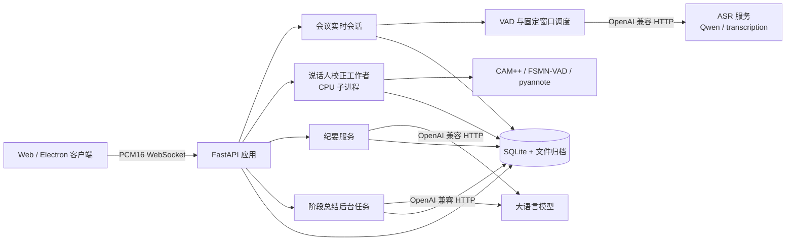

# Audio2Text 会议助手

Audio2Text 是一个面向会议场景的实时语音转写系统。它从浏览器或 Electron 客户端采集麦克风音频，通过 WebSocket 发送到 FastAPI 服务，实时返回临时文字和定稿文字，并在会议结束后完成说话人校正和会议纪要生成。

普通用户请参阅[用户操作手册](docs/user-manual.md)；部署和运维请参阅[部署手册](docs/deployment.md)。

应用服务默认运行在 CPU 环境。ASR 和大语言模型通过 OpenAI 兼容接口调用，因此可以连接远程服务，也可以在 GPU 主机上通过 Compose 启动本地 vLLM。录音、转写和会议元数据都保存在服务端，客户端只负责采集、展示和控制。

## 功能

- 实时麦克风采集和转写，支持开始、暂停、继续和结束。
- 临时文字实时更新，定稿文字按版本保存，断线后可以继续会议。
- 每个会议拥有独立的录音、转写状态和模型会话，同一会议同时只允许一个录音连接。
- 自动区分说话人。无需提前录制声纹样本，身份只在当前会议内有效。
- 会议结束后进行说话人全局校正，并生成结构化 Markdown 纪要。
- 按归档录音时间窗口异步生成阶段总结，通过独立 WebSocket 实时推送，暂停或结束时整理尾段。
- 会议管理、部门管理、历史检索、正文下载、纪要下载和录音 WAV 导出。
- SQLite 保存元数据和任务状态，PCM 音频、结构化转写和纪要保存在数据目录。

说话人识别未配置或模型不可用时，文字转写仍可使用；页面会显示说话人服务未就绪，原始文字不会被删除。

## 架构



### 客户端

`client/` 是 Electron 桌面客户端，使用 React、Vite、AudioWorklet 和 PCM 采集器。`web/` 是浏览器前端，使用 React、TypeScript、Vite 和 Tailwind CSS。两者共用会议 WebSocket 协议和服务端 API。

AudioWorklet 将麦克风混合为单声道 PCM16。优先创建 16 kHz AudioContext；不支持时上传实际采样率，由服务端使用有状态的 soxr 重采样到 16 kHz。

### FastAPI 应用

`app/main.py` 提供 HTTP API、静态前端、会议录音接口 `/ws/meetings/{meeting_id}` 和只读阶段总结接口 `/ws/meetings/{meeting_id}/stage-summaries`。`app/realtime.py` 将录音 WebSocket 绑定到一个会议，负责控制命令、音频输入、识别事件、版本同步和断线恢复。

录音导出接口为 `GET /api/meetings/{meeting_id}/audio/download`。服务端读取该会议的 `audio/manifest.json`，按清单顺序流式封装为 WAV，不会将整场录音一次性加载到内存。

`app/asr.py` 负责输入队列、录音归档、模型处理队列和结果队列。音频归档与 ASR 处理分离：识别变慢时仍先保存音频，队列达到硬上限后才停止录音并保留已经定稿的内容。

归档格式是 16 kHz、单声道、16 位小端 PCM 分片。导出时只读取清单声明的采样范围，录音中断后遗留在分片文件末尾的未提交字节不会进入 WAV 文件。

`app/diarization/` 是独立的 CPU 说话人校正工作者。它通过持久化任务状态和事件日志支持重启恢复，不阻塞实时录音连接。

`app/stage_summaries.py` 根据 16 kHz 归档采样数划分非重叠窗口。ASR 定稿只发送内存水位通知；暂停/结束会先持久化准确的封口边界，但不会等待 LLM。后台工作者负责 LLM 调用、最多三次瞬时失败重试和 WebSocket 推送，因此录音协程不承担模型推理。服务重启后，生成中的窗口恢复为待处理状态，并根据已登记会议的归档和定稿转写补齐尚未入库的窗口。

### 数据层

SQLite 保存会议、部门、模型配置和任务状态。转写事件、结构化快照、PCM 分块、说话人特征和纪要使用文件保存。结构化事件日志是转写正文的事实来源，`transcript.txt` 和页面内容属于派生投影。

## 模型选型

### ASR

ASR 配置在页面“模型配置”中保存，包括 API 地址、模型名、API Key、超时时间和识别模式。配置存储在服务端 SQLite，客户端不保存服务端密钥。

| 模式 | 请求接口 | 适用场景 | 行为 |
| --- | --- | --- | --- |
| `qwen_streaming` | `/chat/completions` | Qwen3-ASR 和支持前缀续写的 vLLM | 固定滚动音频窗口，使用 assistant 前缀和末尾 token 回退继续生成 |
| `transcription` | `/audio/transcriptions` | 只支持文件转写的 OpenAI 兼容服务 | 使用相同固定窗口，通过重叠文字合并临时结果 |

两种模式都不会提交不断增长的整段会议音频。默认窗口为 5 秒、步长为 2 秒，模型单次请求大小受到窗口上限约束。窗口和步长由 `ASR_WINDOW_SECONDS`、`ASR_STRIDE_SECONDS` 控制。

Qwen 前缀续写要求服务支持 `input_audio`、assistant 前缀、`continue_final_message=true` 和 `add_generation_prompt=false`。仅支持普通 OpenAI 兼容接口的服务应选择 `transcription` 模式。`ASR_SEND_CHAT_TEMPLATE=true` 时，应用会随请求发送内置模板；对应的 vLLM 服务必须允许请求级模板。

应用进程不加载 Qwen 权重，也不依赖 `qwen_asr`。Qwen 权重由 vLLM 或其他 OpenAI 兼容 ASR 服务加载。Qwen 前缀回退需要本地 tokenizer 文件，但 tokenizer 只用于文本 token 边界处理，不是模型权重。

### 说话人模型

说话人校正运行在应用服务器 CPU 子进程中，采用 FSMN-VAD、CAM++ 中文/英文声纹和 `pyannote/segmentation-3.0` 局部分段。模型只从本地目录读取，不在运行时联网下载。

### 纪要模型

纪要使用独立的大语言模型配置，通过 `/chat/completions` 调用。长会议先按 `LLM_CHUNK_CHARS` 分段提取要点，再合并生成包含结论、决策、待办、风险和下一步安排的 Markdown 纪要。

阶段总结复用同一个大语言模型配置，但任务和连接均与录音链路隔离。默认每 300 秒实际归档录音形成一个窗口；窗口只读取已经定稿的文字，暂停或结束时会封口不足一个完整窗口的尾段。窗口长度和单次最大输出分别由 `STAGE_SUMMARY_WINDOW_SECONDS`、`STAGE_SUMMARY_MAX_TOKENS` 控制。

## 实时处理设计

### 音频链路

```text
AudioWorklet
  → 约 100 ms PCM16 帧
  → WebSocket 二进制消息
  → PCMNormalizer 重采样
  → AudioArchive 持久化
  → SpeechSession 20 ms VAD 帧
  → 固定窗口 ASR
  → partial / final 事件
```

SpeechSession 使用能量阈值、连续有声判断和静音尾部检测：默认连续 60 ms 有声才开始一句，保留约 200 ms pre-roll，连续 600 ms 静音或语音段达到 20 秒时定稿。

### 固定窗口

模型请求由 `RemoteDecoder` 统一调度。每次只提交最近的固定窗口，窗口之间保留重叠：

```text
窗口长度：5 秒
推进步长：2 秒
重叠长度：3 秒
```

Qwen 模式在窗口内继续使用前缀回退；文件转写模式对相邻窗口的文字做最长公共重叠合并。两种模式都按会议内顺序执行请求，避免结果乱序。

固定窗口解决了累计音频导致请求越来越慢的问题，但模型平均处理时间仍应低于步长。若模型处理速度不足，系统会报告 ASR 延迟；积压超过硬上限时会安全暂停并保存已定稿内容。

### 流控和恢复

服务端根据待处理音频量发送 `flow` 事件。客户端显示“转写有延迟”，积压恢复后显示恢复提示，不把普通识别延迟误报为人工暂停。

会议 WebSocket 关闭时，服务端释放会议占用并将录音状态恢复为 `paused`。已归档音频和已定稿文字保留，未完成的临时文字可能丢失。用户可以点击继续，客户端会用同一会议 ID 建立新的录音会话。

### WebSocket 协议

1. 客户端先 `POST /api/meetings` 创建会议，再连接 `/ws/meetings/{id}`。
2. 服务端发送 `ready`，客户端发送 `start` 或 `resume`，并声明 `format=pcm_s16le` 和采样率。
3. 客户端发送 PCM16 二进制帧；服务端返回 `partial`、`final`、`flow`、`processing` 和 `minutes` 事件。
4. 暂停或结束前，客户端停止采集并冲刷尾音；服务端排空识别队列、提交归档，再返回 `state`。
5. 所有事件携带 `meeting_id`。`segment_id` 在整个会议内递增，版本缺口通过 `snapshot` 恢复。
6. 客户端定期发送 `ping`；`pong` 同时携带内存中的 ASR 请求耗时和积压快照。累计录音时长以归档 PCM 采样数为准。

阶段总结使用独立的 `/ws/meetings/{id}/stage-summaries`。连接后首先返回 `stage_summaries.snapshot`，随后按窗口推送 `stage_summary.update`；该连接只接受 `ping`，不接收音频或会议控制。历史结果也可通过 `GET /api/meetings/{id}/stage-summaries` 获取，失败窗口可通过 `POST /api/meetings/{id}/stage-summaries/retry` 重试。

## 导入已有 WAV 创建会议

客户端和 Web 的新建会议弹窗均支持选择“导入 WAV 音频”。上传时携带会议名称、可选部门和识别语言，服务端用 FFmpeg 校验并转换为单声道 16 kHz PCM，按实际采样数计算会议时长（包含静音）。原始文件保留为该会议目录下的 `source.wav`，导出录音使用统一归档生成 WAV。

`app/audio_imports.py` 使用独立的 HTTP 导入任务：

| 接口 | 用途 |
| --- | --- |
| `POST /api/meetings/import` | `multipart/form-data`：`file`（WAV）、`title`，可选 `language`、`department_id`；校验和音频归档完成后返回 `202` 和会议记录 |
| `GET /api/meetings/{id}` | 查看转写及 `import_job` 的阶段、状态、错误和采样进度 |
| `POST /api/meetings/{id}/import/retry` | 重试失败任务，返回 `202`，沿用同一会议和已保存内容 |
| `GET /api/meetings/{id}/minutes` | 查看自动生成的会议纪要 |
| `GET /api/meetings/{id}/download` | 导出已保存的转写正文 TXT |

导入会议的 `source=wav`、会议状态为 `ended`；独立的 `import_job.status` 表示 `queued/running/ready/failed`，`stage` 依次为 `transcribing/diarizing/summarizing`。录音创建的会议保持原有状态流转，`source=recording`、`import_job=null`。导入详情通过 HTTP 轮询更新，不连接录音或阶段总结 WebSocket，也不产生实时阶段总结。

后台顺序读取音频，复用已配置的 ASR 模型适配器、说话人校正与纪要服务；不受实时接收队列的积压限制。任务和转写检查点持久化，重启后自动续处理；多次中断后标记失败，可手动重试。ASR 失败从最后保存的句段继续，总结失败仅重试总结。处理中的导入会议暂不允许删除或手动生成纪要，上传完成后离开页面不影响后台处理。

导入前需配置 ASR 和大语言模型。说话人模型缺失或校正失败时保留转写并继续生成纪要，页面明确显示说话人处理状态，模型就绪后可重试校正。说话人是会议内的匿名编号；重叠讲话沿用现有多说话人标注能力，不提供音源分离或实名声纹匹配。

使用反向代理时，应同步配置上传大小和请求超时；上传请求包含音频校验和归档时间。

默认一次处理一个导入任务。导入与实时录音仍会共享配置的模型服务和说话人工作者，长音频场景的实际吞吐与实时延迟需要按部署资源验收。

## 部署方案

生产环境的网络拓扑、HTTPS/WebSocket 代理、模型配置、备份恢复、升级回滚及客户端发布步骤见 [部署手册](docs/deployment.md)。

### 方案 A：应用服务 + 远程模型

这是最简单的部署方式。应用运行在 CPU 服务器，ASR 和大语言模型地址填写可从该服务器访问的 OpenAI 兼容地址。

```bash
cp .env.example .env
docker compose --profile app up -d --build app
```

访问 `http://localhost:8000`。如果 ASR 服务运行在另一台机器，模型配置中填写其实际地址；容器内的 `localhost` 只指向应用容器自身。

### 方案 B：本机或同一 Compose 中运行 vLLM

GPU 主机需要 NVIDIA Container Toolkit 和本地 Qwen3-ASR 权重。默认 Compose 配置使用 Qwen ASR 镜像，并将模型以只读方式挂载到 vLLM 容器。

```bash
cp .env.example .env
# 按实际权重目录修改 VLLM_MODEL_PATH 和 VLLM_MODEL
docker compose --profile gpu up -d vllm
```

同一 Compose 网络内，应用应使用 `http://vllm:8001/v1`；宿主机运行应用时使用 `http://localhost:8001/v1`。需要同时启动应用和 vLLM 时：

```bash
docker compose --profile gpu --profile app up -d --build
```

使用 Qwen 前缀续写时，将 `ASR_SEND_CHAT_TEMPLATE=true`，并确保 vLLM 启动参数允许 `--trust-request-chat-template`。如果服务模板已经支持 assistant 前缀，也可以保持该开关为 `false`。

### 方案 C：宿主机开发运行

依赖 Python 3.12、uv、Node.js 24，以及 `libgomp1`、`libsndfile1` 和 FFmpeg：

```bash
uv sync
uv run uvicorn app.main:app --reload --host 0.0.0.0 --port 8000
```

浏览器前端：

```bash
npm ci --prefix web
npm run dev --prefix web
```

开发服务器默认运行在 `http://localhost:5173`，并将 `/api` 和 `/ws` 代理到 8000 端口。生产构建：

```bash
npm run build --prefix web
```

Electron 客户端：

```bash
npm ci --prefix client
npm run dev --prefix client
```

Windows 标准版（Electron 35.7.5）安装包和便携版使用 `npm run dist:win --prefix client` 生成；Win7 64 位兼容版（Electron 22.3.27）使用 `npm run dist:win7 --prefix client`，输出到 `client/release/win7/`。同时生成两版可使用 `npm run dist:win:all --prefix client`。详见 [部署手册](docs/deployment.md)。桌面客户端中的会议服务地址必须指向可访问的 FastAPI 服务。

## 配置

常用环境变量如下：

| 变量 | 默认值 | 用途 |
| --- | --- | --- |
| `DATA_DIR` | `data/archives` | 会议数据库和文件归档目录 |
| `DATABASE_PATH` | 数据目录下的 `meetings.sqlite3` | 可选的 SQLite 路径 |
| `ASR_TOKENIZER` | `data/tokenizers/qwen` | Qwen 前缀回退所需的本地 tokenizer |
| `ASR_SEND_CHAT_TEMPLATE` | `false` | 是否发送内置 Qwen chat template |
| `ASR_WINDOW_SECONDS` | `5` | ASR 固定窗口长度 |
| `ASR_STRIDE_SECONDS` | `2` | ASR 窗口推进步长 |
| `DIARIZATION_MODEL_DIR` | `models/diarization` | CAM++、FSMN-VAD 权重目录 |
| `DIARIZATION_SEGMENTATION_DIR` | `models/pyannote/segmentation-3.0` | segmentation 权重目录 |
| `DIARIZATION_WORKERS` | `1` | 说话人后台工作者数量 |
| `DIARIZATION_THREADS` | `2` | 每个工作者的推理线程数 |
| `AUDIO_IMPORT_MAX_BYTES` | `5368709120` | 单个 WAV 上传大小上限（5 GiB） |
| `AUDIO_IMPORT_MAX_SECONDS` | `28800` | 导入音频时长上限（8 小时） |
| `AUDIO_IMPORT_WORKERS` | `1` | 同时处理的导入任务数 |
| `AUDIO_IMPORT_DECODE_TIMEOUT_SECONDS` | `600` | 上传后音频校验和归档的超时秒数 |
| `LLM_MAX_TOKENS` | `16384` | 纪要模型最大输出 token |
| `LLM_CHUNK_CHARS` | `12000` | 长会议纪要分段字符数 |
| `STAGE_SUMMARY_WINDOW_SECONDS` | `300` | 阶段总结的归档录音窗口长度 |
| `STAGE_SUMMARY_MAX_TOKENS` | `1200` | 单个阶段总结最大输出 token |

Compose 会将 `data/`、说话人模型目录和 tokenizer 目录挂载到应用容器。模型文件缺失时应用直接报告未就绪，不尝试联网下载。

## 数据和备份

默认目录结构：

```text
data/archives/
  meetings.sqlite3
  meetings/<meeting-id>/
    source.wav  # 仅导入会议保存原始文件
    audio/*.pcm
    audio/manifest.json
    events.jsonl
    transcript.json
    transcript.txt
    speaker-state.json
    speaker-features.jsonl
    speaker-timeline.jsonl
    speaker-corrections.json
    minutes.md
```

备份时需要同时保留 SQLite 文件和 `meetings/` 目录。运行中的数据库应使用 SQLite 备份工具，或先停止应用再复制整个归档目录。应用重启后，未结束的会议会恢复为暂停状态。

## 验证

```bash
UV_CACHE_DIR=/tmp/uv-cache uv run pytest -q
npm run build --prefix web
npm run build --prefix client
npm run test:protocol --prefix client
docker compose --profile app config --quiet
```

测试覆盖会议状态、WebSocket 协议、PCM 重采样、固定窗口 ASR、阶段总结窗口与独立推送、慢识别时的录音归档、断线恢复、说话人校正和纪要任务。真实模型的识别质量和长会议延迟需要在目标部署环境中单独验收。
